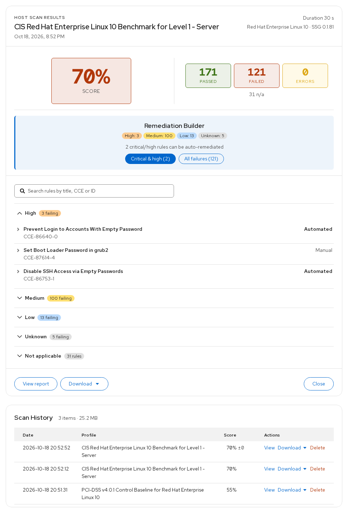
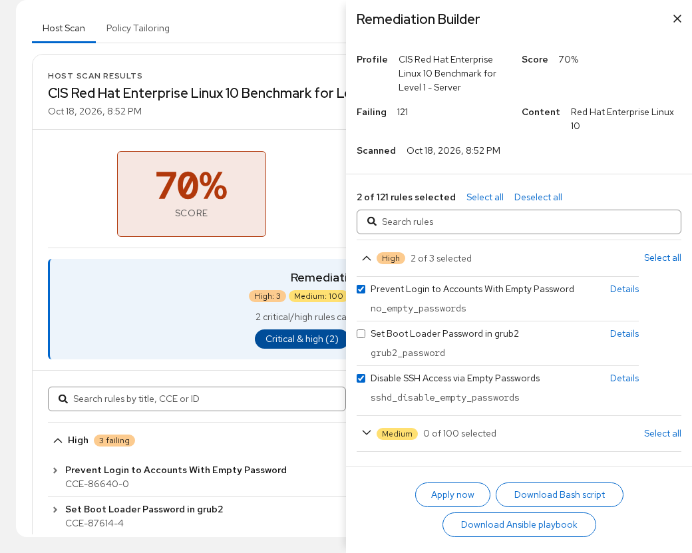
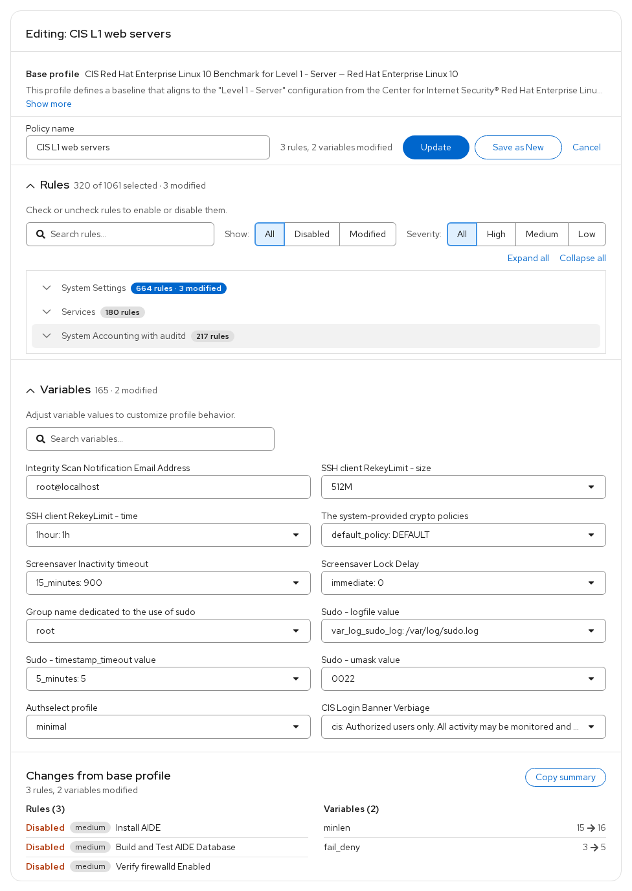
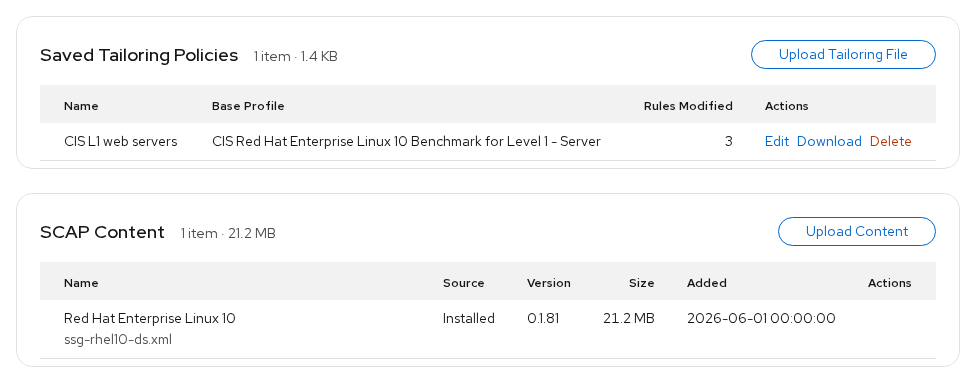

# cockpit-scap

A [Cockpit](https://cockpit-project.org/) module for OpenSCAP. It scans the host Cockpit runs
on, shows the results, builds remediation scripts, and creates XCCDF tailoring files.

> **Note:** This is an independent community project and is not an official Red Hat product or affiliated with Red Hat, Inc.

## Installation

Install the RPM from the [GitHub releases](https://github.com/pbuchan-rh/cockpit-scap/releases)
page:

```bash
sudo dnf install ./cockpit-scap-4.6.0-1.el10.noarch.rpm
```

Then reload Cockpit and open **SCAP Security** in the sidebar.

## Requirements

- Cockpit 286 or later.
- `openscap-scanner` (required; the RPM pulls it in).
- `scap-security-guide` (recommended; installed by default with the RPM unless weak
  dependencies are disabled). Without it, upload your own SCAP datastream.

If OpenSCAP or any SCAP content is missing, the module says so and offers the install
command (and an Install button when a package manager is available).

## Features

**Host Scan**

- Pick the content, profile and an optional saved tailoring policy, then run the scan.
  Content is every SCAP datastream (`*-ds.xml`) under `/usr/share/xml/scap/` ("Installed")
  plus any datastream you uploaded ("Uploaded").
- View Compliance Guide opens the `oscap` guide for the selected profile and tailoring.
  Download Remediation saves a Bash, Ansible or Puppet remediation for the whole profile,
  without a scan.
- Live `oscap` output while the scan runs, with a time-left estimate and Cancel.
- Results: score, pass/fail counts, failing rules by severity, and per-rule details.
  Download the HTML report, results XML and ARF.
- **Remediation Builder**: choose failing rules and download a Bash script or Ansible
  playbook for just those rules, generated with the scan's own profile and tailoring.
- **Apply now**: run the selected Bash fixes on the host, after confirmation and with admin
  access. The run continues as a transient systemd unit if the page closes; its output is
  kept with the scan, and start and end are logged to the system journal.
- **Scan History**: every completed scan is saved, with the score change from the previous
  scan of the same profile. View, download or delete a saved scan.

**Policy Tailoring**

- Create a tailoring policy from a content file and base profile: enable or disable rules,
  change variable values, see the changes from the base profile, and save it.
- **Saved Tailoring Policies**: edit, download, delete, or upload an existing XCCDF
  tailoring file.
- **SCAP Content**: the installed and uploaded datastreams; upload a vendor or custom
  datastream, or delete an upload.

## Screenshots

Scan results, with Scan History below them:



Remediation Builder, with failing rules selected:



Policy Tailoring editor:



Saved Tailoring Policies and SCAP Content:



## Storage

Everything is stored per user in the Cockpit user's home directory, owned by that user:

| Path | Contents |
|---|---|
| `~/SCAP/scans/` | Scan History (results, report, ARF, Apply now logs) |
| `~/SCAP/tailoring/` | Saved tailoring policies |
| `~/SCAP/content/` | Uploaded SCAP datastreams |

Scans run in a root-owned temp directory (`/tmp/cockpit-scap-XXXXXX`) that is removed
afterwards. Nothing is written to `/var/lib/`, and no SELinux policy is shipped or needed.

## Privilege model

Cockpit's `{ superuser: "require" }` is used only where root is needed: running the scan,
reading its result files, and Apply now. Browsing content, tailoring, uploads and Scan
History need no elevation. The forms are always visible; Run Scan and Apply now stay
disabled until administrative access is turned on.

## Building from source

React 18 + PatternFly 6, built with esbuild (the same stack as `cockpit-podman`).

```bash
git clone https://github.com/pbuchan-rh/cockpit-scap.git
cd cockpit-scap
make            # npm install, fetch Cockpit's pkg/lib, build dist/
make rpm        # or: sudo make install
```

## Troubleshooting

See [TROUBLESHOOTING.md](TROUBLESHOOTING.md) for known issues on CIS-hardened hosts (masked
Cockpit service, `use_pty`, sudoers entries removed by remediation).
